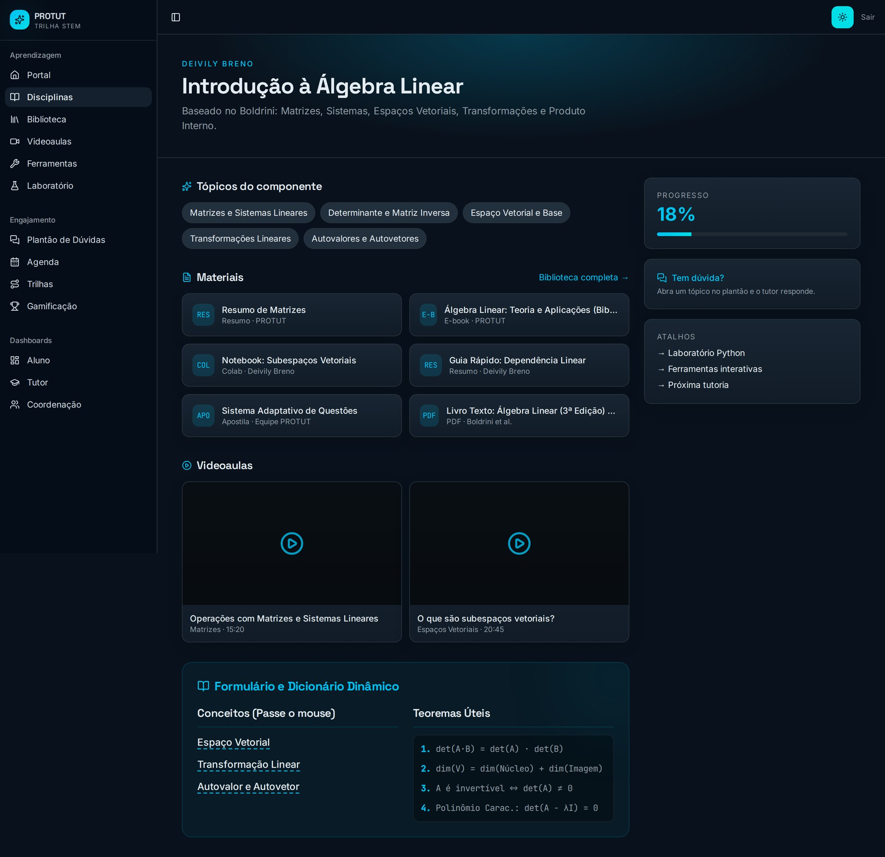
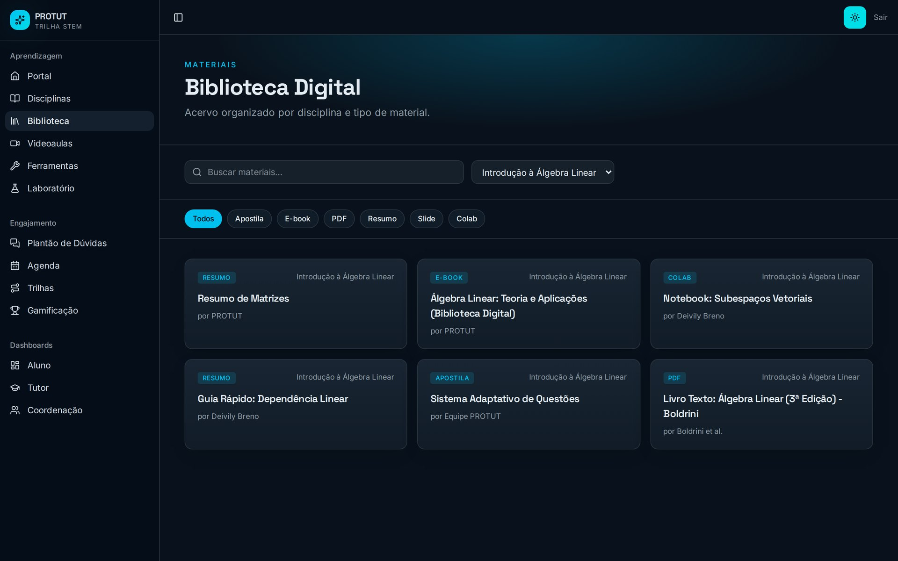
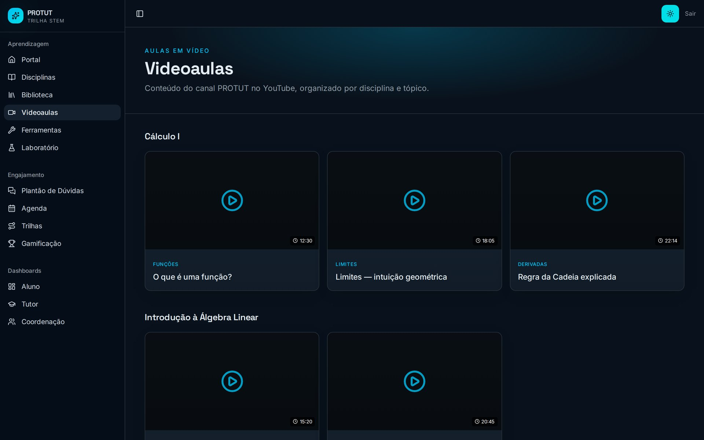
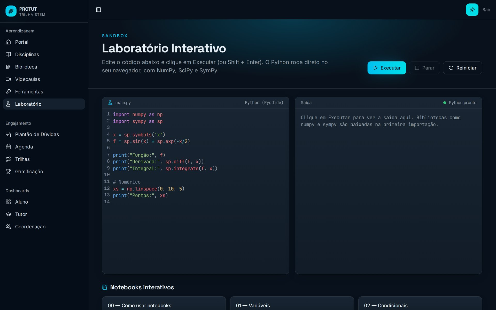
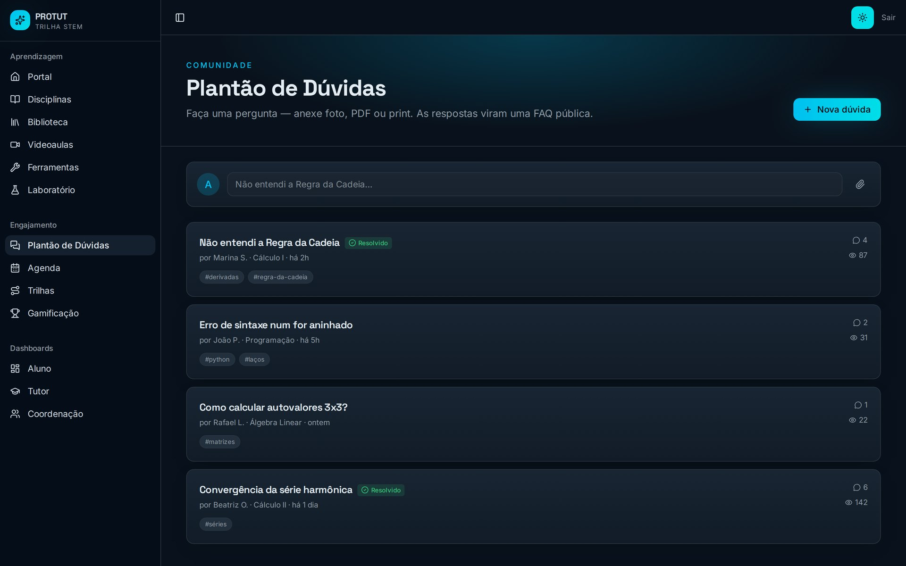
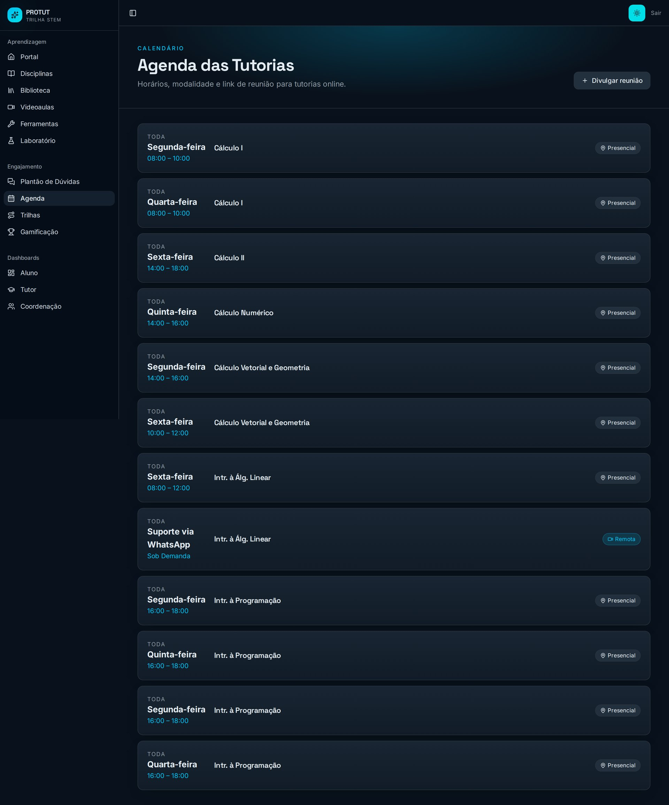
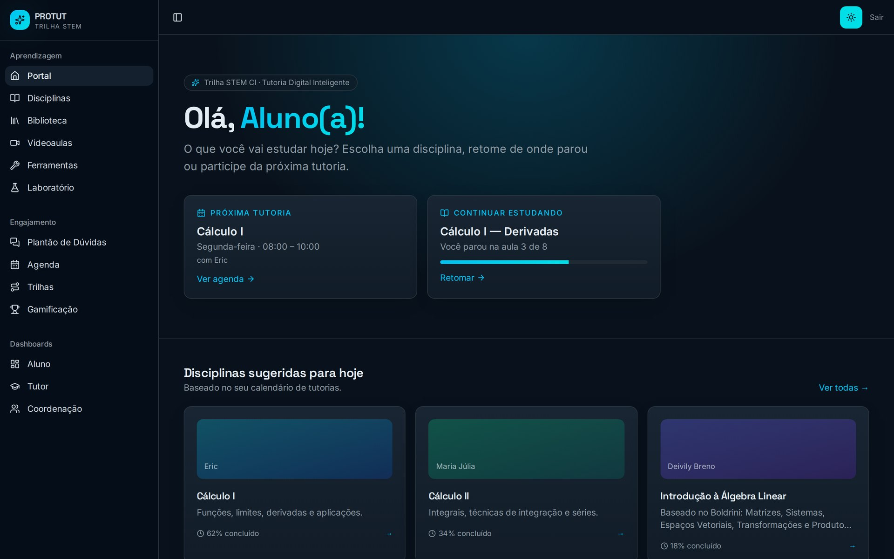
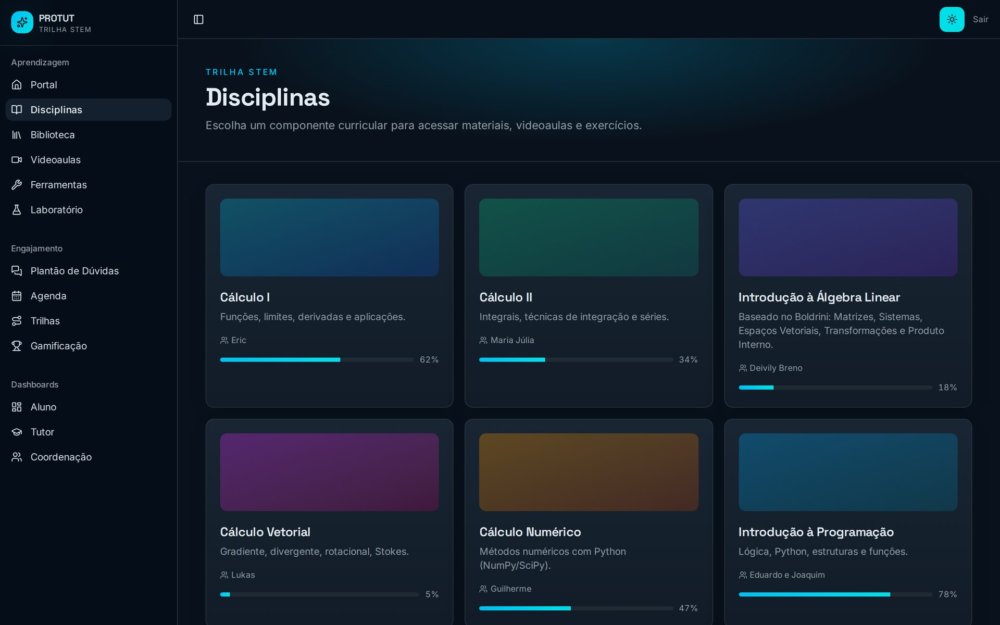

# PROTUT · Tutoria Digital Inteligente

Telas do portal **Tutoria Digital Inteligente**, em desenvolvimento pela equipe de tutores do PROTUT no Centro de Informática (CI) da UFPB, com foco na tutoria de **Introdução à Álgebra Linear**.

> Banner apresentado no XXVIII ENID (Encontro Unificado UFPB 2026): *Relato de Experiência da Tutoria em Introdução à Álgebra Linear: o uso de plataformas digitais como estratégia de apoio à aprendizagem e seus desafios.*
>
> O portal é um protótipo: as telas usam dados de exemplo.

## Introdução à Álgebra Linear

Tópicos do componente, materiais e videoaulas da disciplina.

## Biblioteca Digital

Acervo filtrado por disciplina: resumos, e-books, notebooks e o livro-texto (Boldrini).

## Videoaulas

Videoaulas organizadas por disciplina e tópico.

## Laboratório de Python

Código Python executado direto no navegador, com NumPy, SciPy e SymPy.

## Plantão de Dúvidas

Fórum em que os alunos abrem dúvidas e os tutores respondem.

## Agenda de Tutorias

Horários e modalidade (presencial ou remota) de cada tutoria.

## Visão geral

---

Equipe: Tatiana Araújo Simões e Moisés Dantas dos Santos (orientadores) · Deivily Breno Silva Carneiro (tutor bolsista) · PRG/UFPB.
